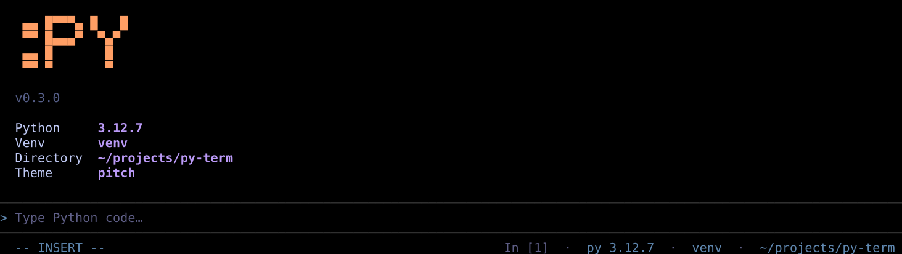
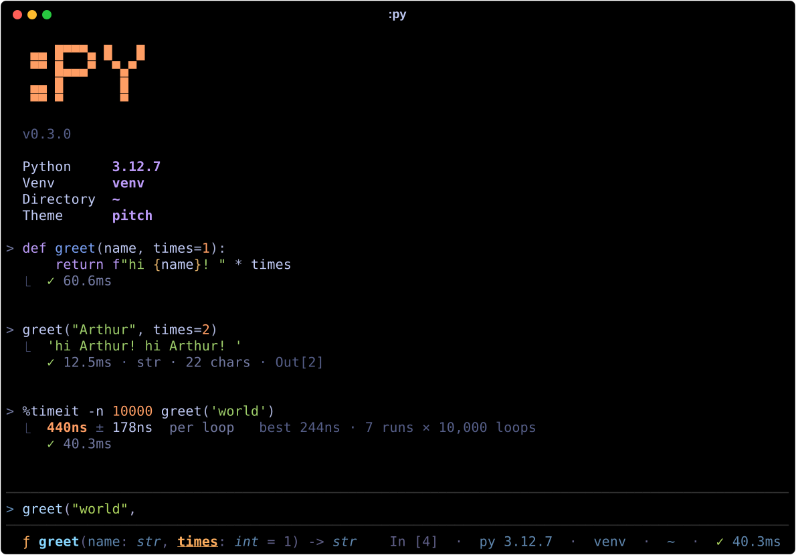

<div align="center">



# ✦ :py

**A modern, beautiful interactive Python shell.**
IPython's power — magics, history, debugging, extensions — rebuilt around a calm terminal UI.

[](https://github.com/arthurdaquinosilva/py-term/tags)
[](https://github.com/arthurdaquinosilva/py-term/actions/workflows/tests.yml)
[](https://github.com/arthurdaquinosilva/py-term/blob/main/pyproject.toml)
[](https://github.com/arthurdaquinosilva/py-term/blob/main/LICENSE)

</div>

## See it in action

<p align="center">

</p>

## Why :py

- **Readable sessions.** Every cell is a block: your code, its output on a rail, and a footer with status, time, result type and `Out[N]`.
- **Help while you type.** Completions with type icons, and live signatures with declared *and* inferred types — `greet(name: str, times: int = 1) -> str` — even for functions without annotations.
- **Everything you use IPython for.** 85 magics, `obj?`, `!shell`, session history in SQLite, `%autoreload`, `%debug`, `%timeit`, `%prun`, top-level `await`, GUI event loops…
- **Runs IPython code.** `get_ipython()`, `IPython.display`, custom magics and IPython extensions like `line_profiler` work unchanged.
- **Feels good.** Paste code straight from docs (`>>>` prompts are stripped), Shift+Enter for new lines, vi or emacs keys, the shared pitch palette, three layouts.

## Install

```sh
curl -fsSL https://raw.githubusercontent.com/arthurdaquinosilva/py-term/main/install.sh | sh
```

The installer picks a suitable Python, downloads the latest release from GitHub, checks it against the release's SHA256SUMS and installs it into its own virtual environment (using [pipx](https://pipx.pypa.io/) if you have it), linking the `:py` command into `~/.local/bin`. Nothing is added to your projects' environments. Run it again to update. Other options:

```sh
curl -fsSL .../install.sh | PY_TERM_VERSION=0.1.0 sh     # a specific release (default: the latest)
curl -fsSL .../install.sh | PY_TERM_VERSION=main sh      # the development version
curl -fsSL .../install.sh | sh -s -- --uninstall      # remove it (settings and history are kept)
```

Or with a tool installer you already use:

```sh
pipx install git+https://github.com/arthurdaquinosilva/py-term.git@v0.1.0
uv tool install git+https://github.com/arthurdaquinosilva/py-term.git@v0.1.0
```

:py isn't on PyPI; GitHub is the only place it's published. Then run `:py`. Requires Python 3.10+ on macOS or Linux.

> **Tip:** :py runs code with the Python it's installed into. To work with a project's packages, install :py inside that project's virtual environment: `pip install https://github.com/arthurdaquinosilva/py-term/archive/refs/heads/main.tar.gz`.

## Quick tour

```python
> import json
> data = {"name": ":py", "tags": ["repl", "python"]}
> data?                     # inspect any object (?? shows the source)
> json.*load*?              # wildcard name search
> files = !ls               # shell output as a list with .grep() / .fields()
> %timeit sorted(range(1000))
> %history -g json          # search history across sessions
> %xmode verbose            # tracebacks with local variables
> %debug                    # debugger on the last error (or breakpoint() in your code)
> %help                     # every key, syntax and magic
```

| | |
| --- | --- |
| **Enter** | run the cell (adds a newline while a block is unfinished) |
| **Shift+Enter** · Alt+Enter · Ctrl+J | insert a newline |
| **Tab** / Shift+Tab | complete · indent / dedent |
| **→** | accept the grey suggestion from history |
| **↑ ↓** · Ctrl+R | history · search history |
| **Ctrl+O** | edit the cell in `$EDITOR` |
| **Ctrl+C** · **Ctrl+D** | clear input / interrupt · exit |

Shift+Enter needs a terminal that reports modified keys (iTerm2, WezTerm, Ghostty, kitty, xterm; inside tmux set `extended-keys on`). Alt+Enter and Ctrl+J work everywhere.

## Documentation

| Guide | What's inside |
| --- | --- |
| [Features](https://github.com/arthurdaquinosilva/py-term/blob/main/docs/features.md) | The interface, input syntax, display, [errors & debugging](https://github.com/arthurdaquinosilva/py-term/blob/main/docs/features.md#errors-and-debugging), history, shell, GUI and completion |
| [Magic reference](https://github.com/arthurdaquinosilva/py-term/blob/main/docs/magics.md) | All 85 magics with options (generated from the code) |
| [Configuration](https://github.com/arthurdaquinosilva/py-term/blob/main/docs/configuration.md) | `config.toml`, layouts and themes, profiles, startup files, command-line options |
| [IPython compatibility](https://github.com/arthurdaquinosilva/py-term/blob/main/docs/ipython-compatibility.md) | `get_ipython()`, custom magics, extensions, display protocol, what's different |
| [Releasing](https://github.com/arthurdaquinosilva/py-term/blob/main/docs/releasing.md) | How versions are tagged and released on GitHub |

## Command line

```sh
:py                        # interactive
:py script.py args…        # run a file (-i to stay interactive afterwards)
:py -m package.module      # run a module
:py -c "print('hi')"       # run a command
:py --profile work --vi --no-startup
:py --doctor               # versions and terminal facts for a bug report
```

## Development

```sh
git clone https://github.com/arthurdaquinosilva/py-term.git && cd py-term
python -m venv .venv && .venv/bin/pip install -e '.[dev]'
.venv/bin/python -m pytest --cov        # unit tests with coverage
.venv/bin/ruff check . && .venv/bin/ruff format --check . && .venv/bin/mypy   # lint, format, types
.venv/bin/python scripts/gen_magic_docs.py   # regenerate docs/magics.md
.venv/bin/python scripts/screenshot.py       # re-record docs/assets/demo.svg
.venv/bin/python scripts/cover.py            # re-record docs/assets/cover.svg
```

:py is built on [prompt_toolkit](https://github.com/prompt-toolkit/python-prompt-toolkit) (input and layout), [Rich](https://github.com/Textualize/rich) (output), [Jedi](https://github.com/davidhalter/jedi) (completion and signatures) and [Pygments](https://pygments.org/) (highlighting).

## Known limits

- Terminal only — no Jupyter kernel; images (`Image`, `SVG`, `%matplotlib inline`) show a placeholder.
- `!cmd` streams through a pipe, so fully interactive programs (vim, less) should run outside :py.
- With the real IPython installed, :py leaves it untouched, so libraries calling IPython's own `get_ipython()` see no shell.

## License

[MIT](https://github.com/arthurdaquinosilva/py-term/blob/main/LICENSE) © Arthur D'Aquino
